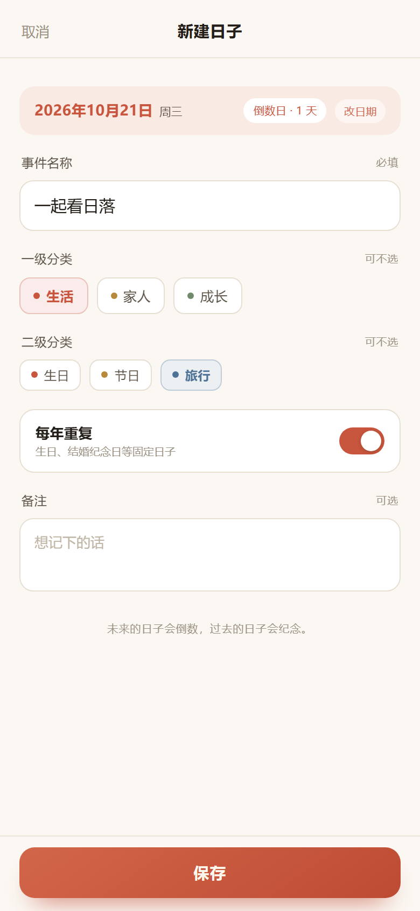
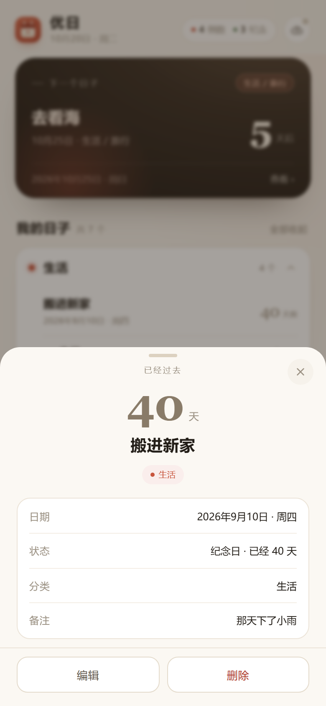
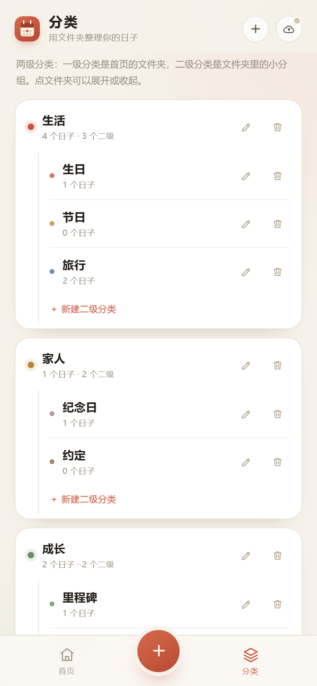

# 优日


一个安静、简洁的纪念日与倒数日手机应用（Android）。

首页只做两件事：把值得记住的日子列出来，并告诉你「还有多少天」或「已经多少天」。
日历只在新建 / 编辑日子时出现，选好日期就能顺手填上名字。

当前版本：**1.0.1**

## 功能

- **首页展示**：顶部卡片突出下一个日子，下面按分类文件夹列出全部日子；未来的显示「天后」，过去的显示「天前」，当天显示「今天」。
- **日历选日期**：新建时打开月历，支持切换年月、快速跳转年份；选中日期后日历自动收起，显示「倒数日 / 纪念日」与天数，事件名称就在下方填写，点「改日期」可重新打开日历。
- **两级分类**：一级分类是首页的文件夹，二级分类是文件夹里的分组，最多两级。
- **文件夹展开 / 收起**：点一级、二级分组都能展开收起，状态会记住；「全部收起 / 全部展开」一键切换。
- **每年重复**：适合生日、纪念日；过去的日子也能看到下一次的倒数。
- **坚果云备份**：通过坚果云 WebDAV 上传 / 恢复备份，可开启自动备份；换手机后连接同一账号恢复即可。
- **本地存储**：数据保存在手机本地，离线可用，不上传其他服务器。

## 更新日志

### 1.0.1

- 修复键盘弹出时页面被压缩、只显示顶部一小块的问题。
- 应用内标题标识换成日历图标；启动器图标、启动图、favicon 同步更新。
- 新增坚果云 WebDAV 同步与备份、自动备份。
- 选好日期后不再自动弹出键盘，避免挡住分类和保存按钮。
- 分类弹窗不再自动聚焦输入框。

## 预览

| 首页 | 日历新建 |
| --- | --- |
|  |  |

| 填写事件 | 日子详情 |
| --- | --- |
|  |  |

| 两级分类 |
| --- |
|  |

| 坚果云同步 |
| --- |
|  |

## 坚果云同步

1. 在坚果云网页版右上角「账户信息 → 安全选项」里添加一个**应用密码**（不是登录密码）。
2. 打开 App 首页右上角的云朵按钮，填写坚果云账号与应用密码，点「保存并测试连接」。
3. 连接成功后可以「立即上传」或「从云端恢复」；打开「自动备份」后，每次修改都会自动上传。

- 备份文件默认是坚果云根目录的 `/youri-backup.json`，只包含日子和分类，不包含账号密码。
- 「从云端恢复」会用云端数据覆盖本机当前数据，操作前会显示两边的日子数量并确认。
- 自动备份是覆盖式快照；多台设备同时修改时，以最后一次上传为准。换设备时建议先恢复，再继续修改。
- 账号与应用密码只保存在本机 localStorage，仅用于访问你自己的坚果云 WebDAV；随时可以在坚果云撤销应用密码。
- 手机 App 通过原生 CapacitorHttp 访问 WebDAV，不受网页跨域限制；浏览器预览则可能因 CORS 无法直连。

## 目录

```
优日/
├─ 手机端/
│  ├─ 优日-1.0.1.apk      # 可直接安装
│  ├─ 使用说明.txt
│  └─ native/             # Capacitor + 原生 Android 工程
│     ├─ www/             # 应用本体（HTML / CSS / JS）
│     ├─ android/
│     └─ build-apk.ps1    # 构建脚本
├─ 预览/                   # 界面截图与图标
└─ 开发/                   # 图标生成、截图、同步与交互回归测试
```

## 构建 APK

需要 JDK 21 与 Android SDK（Capacitor 8，compileSdk 36）。项目会优先使用 `优日/Env`，找不到时复用同级 `同学录/Env` 的工具链。

```powershell
cd 手机端/native
powershell -ExecutionPolicy Bypass -File .\build-apk.ps1
```

脚本会执行 `cap sync`、`gradlew assembleDebug`，并把生成的 APK 复制为 `手机端/优日-<版本>.apk`。

## 说明

- 应用 ID：`com.youri.anniversary`，版本 1.0.1，最低支持 Android 7.0（API 24）。
- 数据只在本机 WebView 的 localStorage 中；卸载应用会一并清除。
- 网页部分可直接在浏览器打开 `手机端/native/www/index.html` 预览；加 `?demo=1` 可载入演示数据（不写入本地）。
