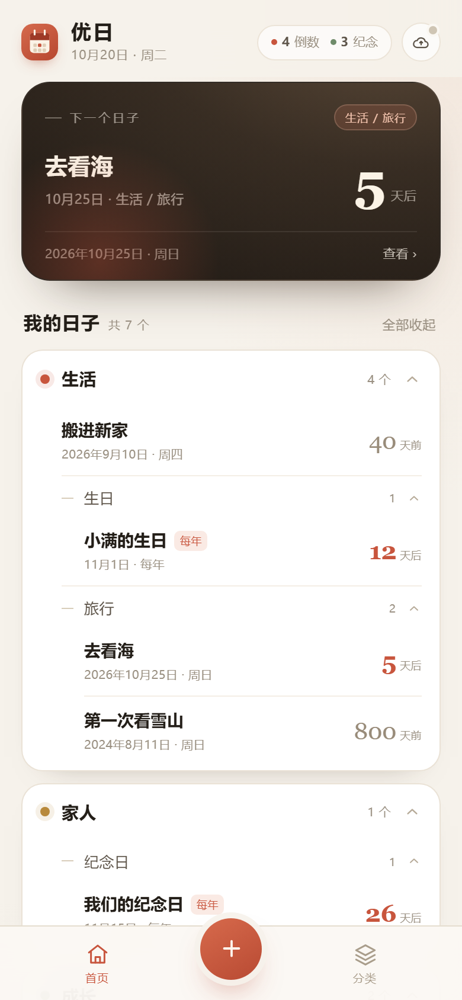
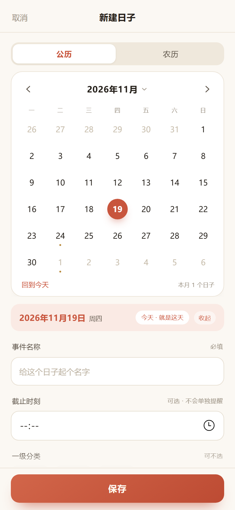
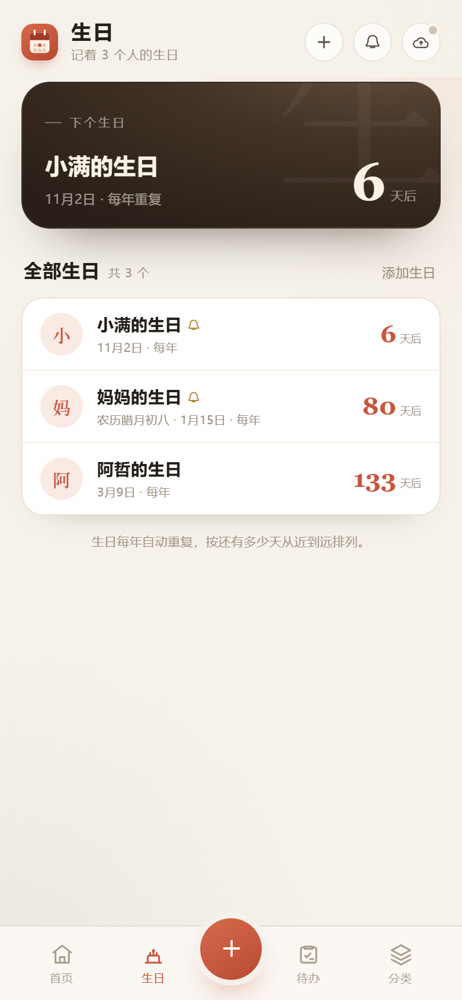
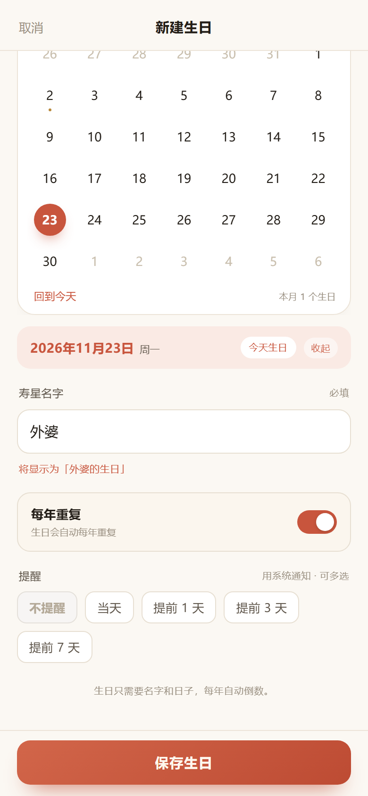
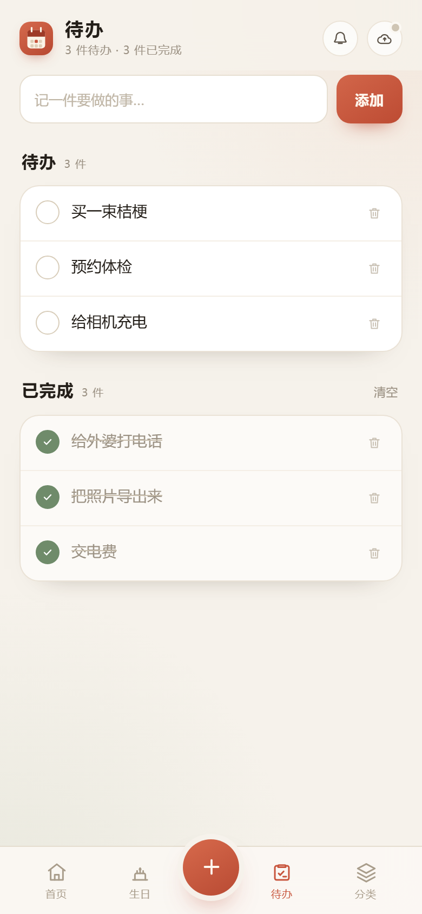
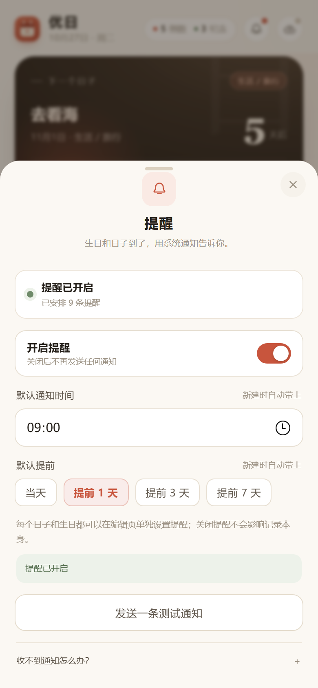
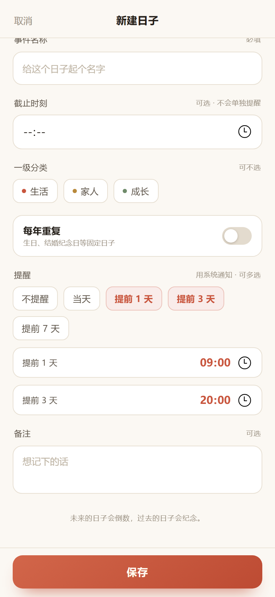
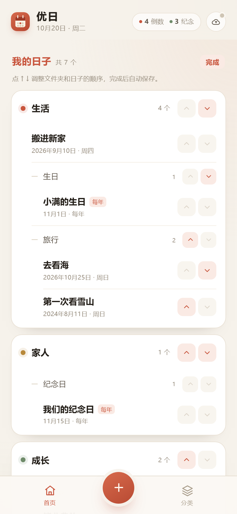
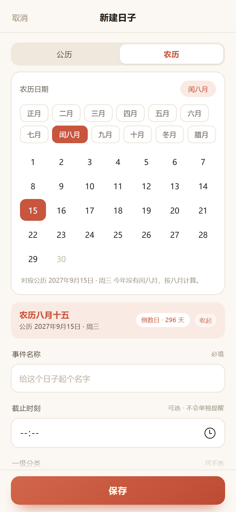
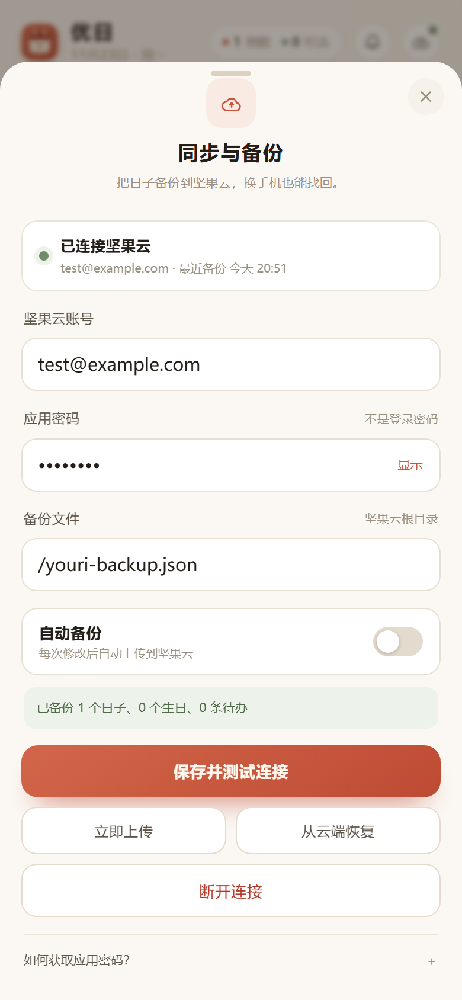

# 优日


一个安静、简洁的纪念日与倒数日手机应用（Android）。

首页只做两件事：把值得记住的日子列出来，并告诉你「还有多少天」或「已经多少天」。
日历只在新建 / 编辑日子时出现，选好日期就能顺手填上名字。
另有两个轻量页面：记生日的「生日」，和随手记小事的「待办」。
到日子时还能用系统通知提醒你。

当前版本：**1.3.1**

## 功能

- **首页展示**：顶部卡片突出下一个日子，下面按分类文件夹列出全部日子；未来的显示「天后」，过去的显示「天前」，当天显示「今天」。
- **日历选日期**：新建时打开月历，支持切换年月、快速跳转年份；选中日期后日历自动收起，显示「倒数日 / 纪念日」与天数，事件名称就在下方填写，点「改日期」可重新打开日历。
- **截止时刻（可选）**：日子可以再补一个具体时刻，比如出发的 09:12；详情页会显示这一行，不填就不显示，也不会单独发通知。
- **农历日期**：新建 / 编辑日子和生日时可在「公历 / 农历」之间切换；选农历后按农历月日换算成当年的公历日期倒数，首页列表、顶部卡片、详情和日历圆点同时显示两者（农历在前）。
- **两级分类**：一级分类是首页的文件夹，二级分类是文件夹里的分组，最多两级。
- **文件夹展开 / 收起**：点一级、二级分组都能展开收起，状态会记住；「全部收起 / 全部展开」一键切换。
- **手动排序**：首页点「排序」，用 ↑ ↓ 调整文件夹（分类）和日子的顺序；顺序会保存在本机，也随坚果云备份。
- **生日**：底部「生日」页单独记录生日，只需要填名字和日期，自动显示为「某某的生日」，固定每年重复，并按还有多少天从近到远排列。
- **待办**：底部「待办」页随手记下要做的事，不需要设截止日期；点圆圈或文字即可完成，完成的会收进「已完成」栏，也可以再点回来或删除。
- **系统提醒**：顶部铃铛里开启通知权限后，可给每个日子 / 生日同时设置多条提醒（当天 / 提前 1、3、7 天可多选，每条各选时间，例如提前 3 天 20:00 + 提前 1 天 09:00），到点用系统通知提醒；每年的日子会自动排到下一次。
- **每年重复**：适合生日、纪念日；过去的日子也能看到下一次的倒数。
- **坚果云备份**：通过坚果云 WebDAV 上传 / 恢复备份，可开启自动备份；日子、生日、待办、提醒和排序会一起备份，换手机后连接同一账号恢复即可。
- **本地存储**：数据保存在手机本地，离线可用，不上传其他服务器。

## 更新日志

### 1.3.1

- 日子和生日支持按农历记录：编辑页新增「公历 / 农历」切换，农历可选正月…腊月与初一…三十，并支持闰月。
- 选了农历后自动换算成当年对应的公历日期来倒数；今年已经过了就算下一年，提醒也按换算后的日期排。
- 首页列表、顶部卡片、详情页与生日页同时显示农历和公历（农历在前）；日历圆点按换算后的公历日期标记。
- 某年没有所选的闰月时按同月普通月计算并给出提示；农历设置随坚果云备份一起保存和恢复。

### 1.3.0

- 新建 / 编辑日子时新增可选的「截止时刻」：选好日期后可以再填一个具体时刻（如 09:12），不填不影响原有用法。
- 日子详情页在「日期」下方显示「截止时刻」，没有填写时不显示这一行。
- 编辑页可点「清除」取消已填的时刻；旧数据、旧云端备份缺少该字段时按未填处理，并随坚果云备份一起保存。

### 1.2.0

- 一个日子 / 生日可以同时设置多条提醒：当天、提前 1、3、7 天可多选，每条各自设置通知时间。
- 编辑页「提醒」改为多选，选中的每个天数各带一行时间；再点一次即可取消该条。
- 详情页按行列出全部提醒；旧版单条提醒会自动读成一条，仍随坚果云备份与恢复。

### 1.1.1

- 接入系统通知权限：首次开启提醒时申请通知授权，并在设置页显示当前权限状态。
- 每个日子 / 生日都能单独设置提醒：当天、提前 1 / 3 / 7 天，并可自选具体时间（如提前一天 09:00）。
- 顶部新增铃铛入口：开启提醒、设置默认提醒时间与默认提前天数、发送测试通知。
- 每年的日子与生日会自动把下一次提醒排上；提醒关闭或删除记录时会同步取消。
- 支持精确闹钟提示：系统未允许「闹钟与提醒」时会给出说明与跳转入口。
- 提醒设置随本机保存，编辑页与详情页都会显示提醒时间；旧数据无需迁移。

### 1.1.0

- 新增「生日」页：底部导航左侧第二个入口，记录寿星名字即可，自动显示「某某的生日」。
- 生日固定每年重复、不用手动开启，列表按还有多少天从近到远排序，顶部卡片突出下一个生日。
- 新增「待办」页：底部加号右侧入口，输入即可添加，点圆圈或文字勾选完成，完成项收进「已完成」栏，可取消完成或删除。
- 待办不需要截止日期；「已完成」支持一键清空。
- 坚果云备份同步加入生日与待办，旧备份仍可正常恢复（缺失的部分按空处理）。

### 1.0.2

- 首页新增「排序」：可手动调整文件夹（一级 / 二级分类）和日子的顺序，点 ↑ ↓ 即可移动。
- 排序结果保存在本机，并随坚果云备份一起同步；换手机恢复后顺序仍然保留。
- 修复首页顶部卡片背景水印字符损坏的问题。

### 1.0.1

- 修复键盘弹出时页面被压缩、只显示顶部一小块的问题。
- 应用内标题标识换成日历图标；启动器图标、启动图、favicon 同步更新。
- 新增坚果云 WebDAV 同步与备份、自动备份。
- 选好日期后不再自动弹出键盘，避免挡住分类和保存按钮。
- 分类弹窗不再自动聚焦输入框。

## 预览

| 首页                      | 日历新建                    |
| ------------------------- | --------------------------- |
|  |  |

| 填写事件                           | 日子详情                    |
| ---------------------------------- | --------------------------- |
|  |  |

| 两级分类                  | 生日                          |
| ------------------------- | ----------------------------- |
|  |  |

| 新建生日                                 | 待办                      |
| ---------------------------------------- | ------------------------- |
|  |  |

| 系统提醒                        | 提醒设置                               |
| ------------------------------- | -------------------------------------- |
|  |  |

| 首页排序                  |
| ------------------------- |
|  |

| 农历日期                          |
| --------------------------------- |
|  |

| 坚果云同步                          |
| ----------------------------------- |
|  |

## 坚果云同步

1. 在坚果云网页版右上角「账户信息 → 安全选项」里添加一个**应用密码**（不是登录密码）。
2. 打开 App 首页右上角的云朵按钮，填写坚果云账号与应用密码，点「保存并测试连接」。
3. 连接成功后可以「立即上传」或「从云端恢复」；打开「自动备份」后，每次修改都会自动上传。

- 备份文件默认是坚果云根目录的 `/youri-backup.json`，包含日子、分类、生日、待办与提醒设置，不包含账号密码。
- 「从云端恢复」会用云端数据覆盖本机当前数据，操作前会显示两边的数量并确认。
- 自动备份是覆盖式快照；多台设备同时修改时，以最后一次上传为准。换设备时建议先恢复，再继续修改。
- 账号与应用密码只保存在本机 localStorage，仅用于访问你自己的坚果云 WebDAV；随时可以在坚果云撤销应用密码。
- 手机 App 通过原生 CapacitorHttp 访问 WebDAV，不受网页跨域限制；浏览器预览则可能因 CORS 无法直连。

## 目录

```
优日/
├─ 手机端/
│  ├─ 优日-1.3.1.apk      # 可直接安装
│  ├─ 使用说明.txt
│  └─ native/             # Capacitor + 原生 Android 工程
│     ├─ www/             # 应用本体（HTML / CSS / JS）
│     ├─ android/
│     └─ build-apk.ps1    # 构建脚本
├─ 预览/                   # 界面截图与图标
└─ 开发/                   # 图标生成、截图、同步与交互回归测试
```

## 构建 APK

需要 JDK 21 与 Android SDK（Capacitor 8，compileSdk 36）。项目会优先使用 `优日/Env`，找不到时复用同级 `同学录/Env` 的工具链。

```powershell
cd 手机端/native
powershell -ExecutionPolicy Bypass -File .\build-apk.ps1
```

脚本会执行 `cap sync`、`gradlew assembleDebug`，并把生成的 APK 复制为 `手机端/优日-<版本>.apk`。

## 说明

- 应用 ID：`com.youri.anniversary`，版本 1.3.1，最低支持 Android 7.0（API 24）。
- 提醒使用 Android 本地通知（通知权限、精确闹钟、开机恢复），全部在本机触发，不联网、不上传提醒内容；可以随时在系统设置里关闭。
- 数据只在本机 WebView 的 localStorage 中；卸载应用会一并清除。
- 网页部分可直接在浏览器打开 `手机端/native/www/index.html` 预览；加 `?demo=1` 可载入演示数据（不写入本地）。
